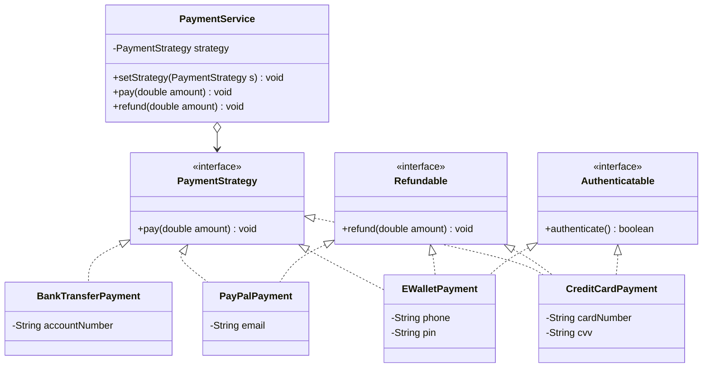

# Lab 04 – Hệ thống thanh toán trực tuyến (Strategy Pattern + ISP)

| | |
|---|---|
| **Họ và tên** | Lê Anh Khoa |
| **MSSV** | 4651050119 |
| **Lớp** | K46D |
| **Bài** | Lab 04 |

---

## 1. Đề bài

Một hệ thống thanh toán trực tuyến hỗ trợ 4 phương thức: thẻ tín dụng, PayPal, ví điện tử, chuyển khoản ngân hàng. Phiên bản đầu tiên được viết bằng chuỗi `if-else` trong một class `PaymentService`.

**Yêu cầu:**
1. Phân tích thiết kế hiện tại để tìm các điểm có thể cải tiến.
2. Thiết kế lại bằng mẫu **Strategy** và áp dụng nguyên lý **ISP**.
3. Viết client code minh họa việc sử dụng.

---

## 2. Phân tích thiết kế hiện tại

Mã nguồn ban đầu:

```java
public class PaymentService {
    public void pay(String method, double amount) {
        if (method.equals("CREDIT_CARD")) { ... }
        else if (method.equals("PAYPAL")) { ... }
        else if (method.equals("E_WALLET")) { ... }
        else if (method.equals("BANK_TRANSFER")) { ... }
        else throw new IllegalArgumentException("Phương thức thanh toán không hợp lệ");
    }
}
```

| # | Vấn đề | Giải thích | Nguyên lý / Code smell |
|---|--------|-----------|------------------------|
| 1 | Chuỗi `if-else` dài | Mỗi phương thức thanh toán là một nhánh trong cùng một hàm | Conditional Statements smell |
| 2 | Thêm phương thức mới phải sửa class cũ | Muốn thêm Apple Pay phải mở `PaymentService` để thêm `else if` | **OCP** (Open/Closed) |
| 3 | Một class ôm nhiều trách nhiệm | `PaymentService` biết cách xử lý cả 4 loại thanh toán | **SRP** (Single Responsibility) |
| 4 | Dùng `String` định danh phương thức | Gõ sai chuỗi chỉ phát hiện lúc chạy, compiler không báo lỗi | Thiếu type-safety |
| 5 | Khó kiểm thử | Muốn test một phương thức vẫn phải đi qua cả chuỗi `if-else` | Khó unit test |
| 6 | Phụ thuộc vào chi tiết cụ thể | Không có abstraction để thay thế hay tái sử dụng | **DIP** (Dependency Inversion) |
| 7 | Không chứa được dữ liệu riêng từng loại | Thẻ cần số thẻ/CVV, PayPal cần email, ví cần số điện thoại, ngân hàng cần số tài khoản, nhưng `pay(String, double)` không mang được | Thiết kế khó mở rộng |

**Kết luận:** vi phạm **OCP** và **SRP** là nghiêm trọng nhất. Giải pháp: tách mỗi thuật toán thanh toán thành một class riêng cùng cài đặt một interface chung (Strategy).

---

## 3. Thiết kế mới

### 3.1. Mẫu Strategy

| Vai trò | Thành phần trong bài |
|---------|----------------------|
| **Strategy** (interface) | `PaymentStrategy` |
| **ConcreteStrategy** | `CreditCardPayment`, `PayPalPayment`, `EWalletPayment`, `BankTransferPayment` |
| **Context** | `PaymentService` (giữ tham chiếu tới `PaymentStrategy`, không biết đó là loại nào) |

### 3.2. Áp dụng ISP

> *"Client không nên bị buộc phải phụ thuộc vào những phương thức mà nó không sử dụng."*

Nếu gom `pay`, `refund`, `authenticate` vào **một** interface lớn thì `BankTransferPayment` bị ép phải cài đặt những phương thức nó không có. Vì vậy tách thành các interface nhỏ theo **khả năng**:

| Interface | Phương thức | Lớp cài đặt |
|-----------|------------|-------------|
| `PaymentStrategy` | `pay(double)` | Cả 4 phương thức |
| `Refundable` | `refund(double)` | Thẻ tín dụng, PayPal, Ví điện tử |
| `Authenticatable` | `authenticate()` | Thẻ tín dụng (CVV), Ví điện tử (PIN) |

`BankTransferPayment` chỉ cài đặt `PaymentStrategy`, không bị ép có `refund` hay `authenticate`.

### 3.3. Sơ đồ lớp



---

## 4. Cấu trúc mã nguồn

```
src/
└── payment/
    ├── PaymentStrategy.java       # Strategy: hành vi cốt lõi pay()
    ├── Refundable.java            # ISP: khả năng hoàn tiền
    ├── Authenticatable.java       # ISP: khả năng xác thực
    ├── CreditCardPayment.java     # ConcreteStrategy
    ├── PayPalPayment.java         # ConcreteStrategy
    ├── EWalletPayment.java        # ConcreteStrategy
    ├── BankTransferPayment.java   # ConcreteStrategy (chỉ PaymentStrategy)
    ├── PaymentService.java        # Context
    └── Main.java                  # Client code
```

Điểm chính trong `PaymentService` (không còn `if-else` theo loại thanh toán):

```java
public void pay(double amount) {
    if (strategy instanceof Authenticatable auth) {   // chỉ xác thực nếu có khả năng này
        if (!auth.authenticate()) return;
    }
    strategy.pay(amount);
}

public void refund(double amount) {
    if (strategy instanceof Refundable r) r.refund(amount);
    else System.out.println("Phương thức này không hỗ trợ hoàn tiền.");
}
```

---

## 5. Client code và kết quả chạy

`Main.java` thực hiện: thanh toán thẻ tín dụng → đổi sang PayPal → ví điện tử → chuyển khoản (thử hoàn tiền để thấy không hỗ trợ) → thêm **Apple Pay** bằng lambda mà không sửa bất kỳ code cũ nào.

**Cách chạy:** mở `Main.java` trong Eclipse → *Run As → Java Application*.

**Kết quả:**

```
Xác thực thẻ tín dụng (CVV): thành công
Thanh toán bằng thẻ tín dụng: 500000.0
Hoàn tiền về thẻ tín dụng: 100000.0
-----------------------
Thanh toán bằng PayPal (khoa@example.com): 250000.0
Hoàn tiền về PayPal: 50000.0
-----------------------
Xác thực ví điện tử (PIN): thành công
Thanh toán bằng ví điện tử (0901234567): 300000.0
-----------------------
Thanh toán bằng chuyển khoản (TK 0123456789): 1000000.0
Phương thức này không hỗ trợ hoàn tiền.
-----------------------
Thanh toán bằng Apple Pay: 150000.0
```

---

## 6. So sánh trước và sau khi cải tiến

| Tiêu chí | Trước | Sau |
|----------|-------|-----|
| Thêm phương thức mới | Sửa `PaymentService` | Tạo class mới, không sửa code cũ (**OCP** ✔) |
| Trách nhiệm | Một class ôm tất cả | Mỗi class một việc (**SRP** ✔) |
| Interface | Không có | Nhỏ, tách theo khả năng (**ISP** ✔) |
| Phụ thuộc | Vào chuỗi `String` | Vào abstraction `PaymentStrategy` (**DIP** ✔) |
| Kiểm thử | Khó | Test riêng từng Strategy |
| Dữ liệu riêng từng loại | Không chứa được | Mỗi class tự giữ qua constructor |

## 7. Kết luận

- Mẫu **Strategy** loại bỏ chuỗi `if-else`, cho phép thêm phương thức thanh toán mới mà không sửa code hiện có và đổi phương thức ngay lúc chạy.
- Nguyên lý **ISP** giúp mỗi lớp chỉ cài đặt những khả năng nó thực sự có (`Refundable`, `Authenticatable`), tránh phương thức thừa.
- Thiết kế mới dễ mở rộng, dễ bảo trì và dễ kiểm thử hơn thiết kế ban đầu.
